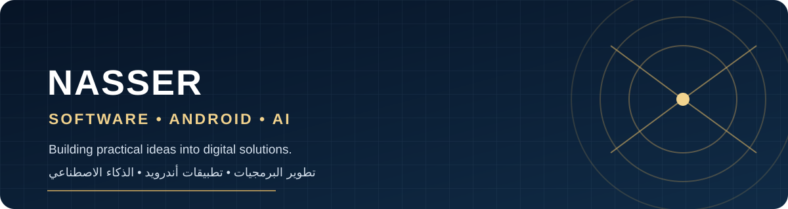

<!--
  GitHub profile README for @nasar721
  Keep this profile focused on real projects and continuous learning.
-->

# ناصر | Nasser

### Software Developer in Progress · Android · AI · Automation

Building practical digital experiences, learning by creating, and turning ideas into working projects.

---

## 👨‍💻 About Me

- 📱 Interested in Android application development.
- 🤖 Exploring artificial intelligence and AI-powered applications.
- ⚙️ Interested in automation and useful software tools.
- 🌱 Learning continuously through practical projects.
- 🎯 Focused on building reliable, simple, and helpful digital solutions.

## 🚀 Featured Project

### [NasserApp](https://github.com/nasar721/NasserApp)
An Android application project under development. Follow the repository for source updates and build progress.

## 🧭 Current Focus

| Area | Focus |
| --- | --- |
| Android | Application structure, UI, and builds |
| Artificial Intelligence | Learning AI integration and safe API architecture |
| Automation | Streamlining repetitive tasks |
| Git & GitHub | Version control, workflows, and project collaboration |

## 🛠️ Tools & Technologies

## 🇸🇦 نبذة بالعربية

أنا ناصر، مهتم بتطوير البرمجيات وتطبيقات أندرويد والذكاء الاصطناعي والأتمتة.

أتعلم من خلال التجربة والعمل على مشاريع عملية، وأسعى إلى تحويل الأفكار إلى تطبيقات وأدوات رقمية مفيدة، مع الاهتمام بجودة التنفيذ والتطوير المستمر.

## 🤝 Connect

- GitHub: [@nasar721](https://github.com/nasar721)
- Explore my repositories: [ github.com/nasar721?tab=repositories ](https://github.com/nasar721?tab=repositories)

---

**Learn · Build · Improve**

